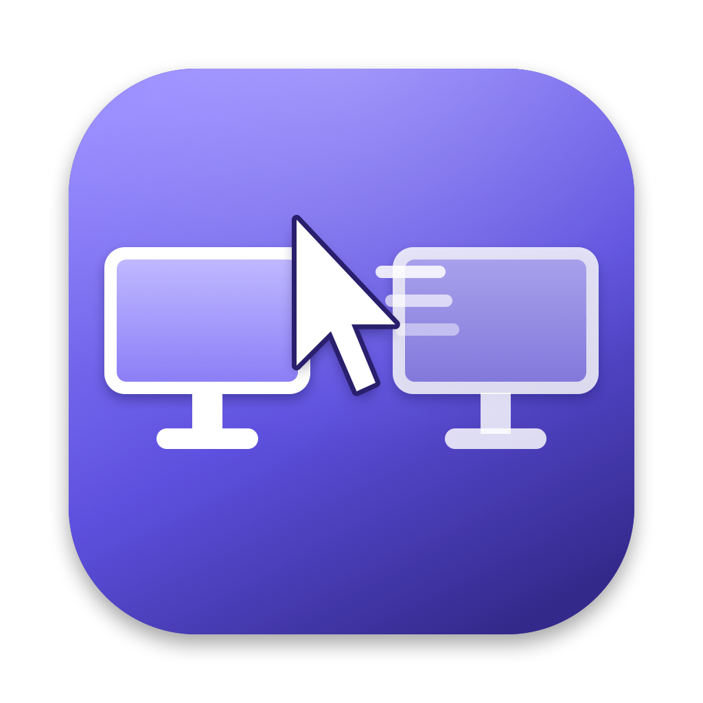

# CornerSwitch

Push the cursor against the edge where your other Mac sits, and your Logitech keyboard and mouse jump to that Mac.



CornerSwitch sends Logitech's own HID++ "change host" command (feature 0x1814) to the devices over Bluetooth, the same thing the Easy-Switch button does. Switching needs no network connection between the Macs, does no discovery, and has no file transfer or clipboard sharing. Both devices need to be paired to both Macs on different Easy-Switch channels.

Tested with the MX Keys S and the MX Master 3S over Bluetooth.

## Install

1. Download `CornerSwitch.dmg` from [Releases](../../releases/latest), open it and drag CornerSwitch to Applications. If you aren't an admin, use `~/Applications` instead, so the app can update itself.
2. Open it. The app is signed with a self-signed certificate, so macOS asks once: go to System Settings > Privacy & Security and click **Open Anyway**.
3. Allow **Input Monitoring** when asked, then reopen the app from its menu bar icon.
4. In the menu bar popover, drag "Other Mac" to the side where that Mac sits, and turn on **Launch at login**.

Do the same on the other Mac, with the arrangement mirrored.

## How it behaves

- **Push to switch**: how hard you push against the edge before it switches (Light, Medium or Firm). It doesn't switch while a mouse button is held, and only outer screen edges count.
- Before switching, the cursor is parked just inside that edge, so coming back feels continuous.
- **Send devices to**: Auto picks the other of channels 1 and 2, based on the channel the devices report for this Mac.

## Updates

The app checks GitHub Releases on launch and every 6 hours. It downloads the new version, checks that it's signed by the same certificate, replaces itself in place and relaunches. There's no reinstall and no duplicate copies, and macOS keeps the Input Monitoring permission.

Publishing an update (needs the signing certificate in the keychain):

```
./release.sh 1.2.0 "What changed"
```

## Diagnostics

```
/Applications/CornerSwitch.app/Contents/MacOS/CornerSwitch --probe       # list devices and channels, changes nothing
/Applications/CornerSwitch.app/Contents/MacOS/CornerSwitch --switch 2    # move both devices to channel 2
```

## Build

`./build.sh` produces a universal `build/CornerSwitch.app`, `.zip` and `.dmg`. It needs the Xcode Command Line Tools. The icon is drawn by `tools/make-icon.swift`.
